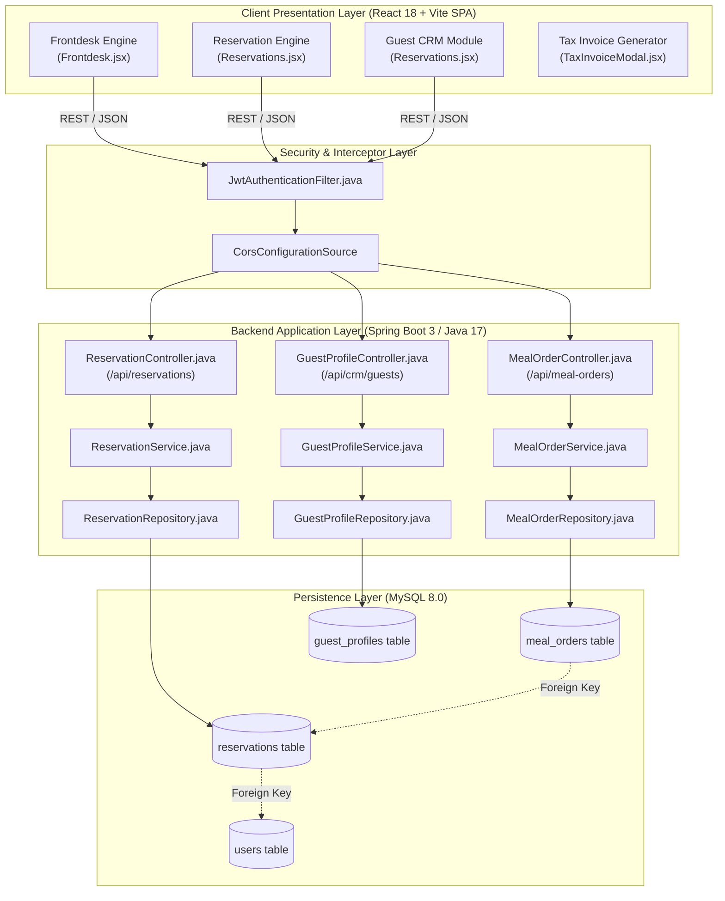
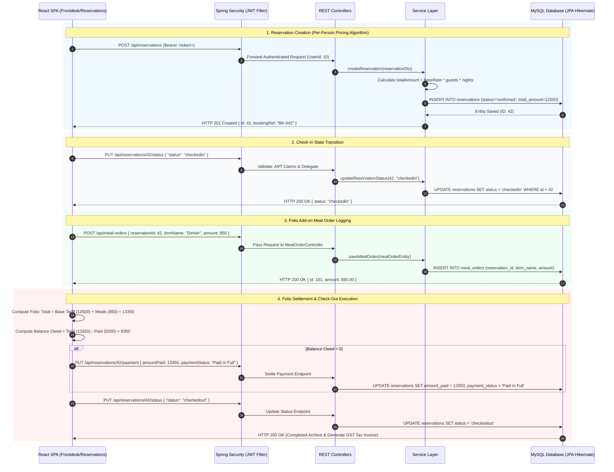

# StayOps PMS Engine: Master Technical Architecture & Specification

This document provides a comprehensive technical architecture specification for the **StayOps Property Management System (PMS)**, covering system components, data flow sequence diagrams, database ER schemas, REST API contracts, and security architecture.

---

## 1. High-Level Component & Layer Architecture



---

## 2. End-to-End Operational Sequence Diagram



---

## 3. Database ER Schema Specifications

### Table 1: `reservations`
| Field Name | Datatype | Constraints | Description |
| :--- | :--- | :--- | :--- |
| `id` | `BIGINT` | Primary Key, Auto-Increment | Database internal primary identifier. |
| `user_id` | `BIGINT` | Foreign Key (`users.id`), NOT NULL | Owner / Manager multi-tenant account link. |
| `property_id` | `BIGINT` | Foreign Key (`properties.id`), NOT NULL | Target homestay/villa reference. |
| `booking_ref` | `VARCHAR(255)` | Unique, NOT NULL | Public reservation code (e.g. `BK-005`). |
| `guest_name` | `VARCHAR(255)` | NOT NULL | Guest full name. |
| `guest_phone` | `VARCHAR(50)` | Indexed | Contact mobile number. |
| `guest_email` | `VARCHAR(255)` | Nullable | Contact email address. |
| `room_unit` | `VARCHAR(100)` | Nullable | Assigned room or villa unit. |
| `check_in` | `DATE` | NOT NULL | Check-in arrival date. |
| `check_out` | `DATE` | NOT NULL | Scheduled departure date. |
| `guest_count` | `INT` | Default `1`, NOT NULL | Number of adult guests ($\text{Per-Person Pricing}$). |
| `total_amount` | `DECIMAL(10,2)` | NOT NULL | Base room tariff calculation. |
| `amount_paid` | `DECIMAL(10,2)` | Default `0.00`, NOT NULL | Total accumulated payments received. |
| `payment_status` | `VARCHAR(50)` | Default `'Pending'` | Status (`Paid in Full`, `Partial`, `Pending`). |
| `status` | `VARCHAR(50)` | Default `'Confirmed'` | Operations state (`confirmed`, `checkedin`, `checkedout`, `no_show`). |

### Table 2: `meal_orders`
| Field Name | Datatype | Constraints | Description |
| :--- | :--- | :--- | :--- |
| `id` | `BIGINT` | Primary Key, Auto-Increment | Meal order primary identifier. |
| `reservation_id` | `BIGINT` | Foreign Key (`reservations.id`) | Target room folio reservation reference. |
| `guest_name` | `VARCHAR(255)` | Nullable | Guest full name. |
| `meal_type` | `VARCHAR(100)` | Nullable | Category (`Dinner 🥘`, `Breakfast 🥞`, `Lunch 🍱`). |
| `item_name` | `VARCHAR(255)` | NOT NULL | Menu item details. |
| `amount` | `DECIMAL(10,2)` | Default `0.00` | Added price to room folio. |
| `created_at` | `DATETIME` | Default `CURRENT_TIMESTAMP` | Order timestamp. |

---

## 4. REST API Endpoint Specifications

### 1. Create Reservation
- **Endpoint**: `POST /api/reservations`
- **Headers**: `Authorization: Bearer <jwt_token>`, `Content-Type: application/json`
- **Request Body**:
  ```json
  {
    "guestName": "Kiran Dev",
    "guestPhone": "9876543210",
    "guestEmail": "kiran@gmail.com",
    "checkIn": "2026-08-29",
    "checkOut": "2026-08-31",
    "guestCount": 2,
    "totalAmount": 12500.0,
    "amountPaid": 5000.0,
    "paymentStatus": "Partial",
    "propertyId": 1
  }
  ```
- **Response**: `HTTP 201 Created`

### 2. Update Operational Status
- **Endpoint**: `PUT /api/reservations/{id}/status`
- **Headers**: `Authorization: Bearer <jwt_token>`, `Content-Type: application/json`
- **Request Body**:
  ```json
  {
    "status": "checkedout"
  }
  ```
- **Response**: `HTTP 200 OK`

### 3. Settle Payment & Folio
- **Endpoint**: `PUT /api/reservations/{id}/payment`
- **Headers**: `Authorization: Bearer <jwt_token>`, `Content-Type: application/json`
- **Request Body**:
  ```json
  {
    "amountPaid": 13350.0,
    "paymentStatus": "Paid in Full"
  }
  ```
- **Response**: `HTTP 200 OK`

### 4. Create Database Meal Order
- **Endpoint**: `POST /api/meal-orders`
- **Headers**: `Content-Type: application/json`
- **Request Body**:
  ```json
  {
    "reservationId": 42,
    "guestName": "Kiran Dev",
    "mealType": "Dinner 🥘",
    "itemName": "Coorg Akki Otti & Chicken Curry x 2",
    "amount": 850.0
  }
  ```
- **Response**: `HTTP 200 OK`

---

## 5. Security & Authentication Architecture

- **Stateless JWT Filter**: Requests pass through `JwtAuthenticationFilter.java` validating HMAC SHA-256 tokens in `Authorization: Bearer <token>`.
- **CORS Configuration**: Allowed origins configured via `CorsConfigurationSource` to accept credentials from `http://localhost:5173`.
- **RBAC & Multi-Tenancy**: All DB queries in `ReservationRepository` scope by `user_id` extracted from JWT claims (`jwtService.extractUserId(token)`), ensuring strict multi-tenant data isolation between property owners.
